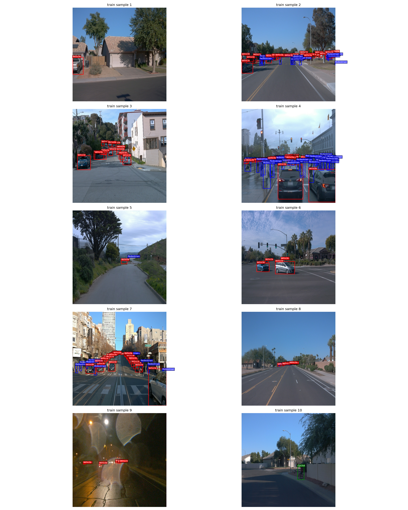
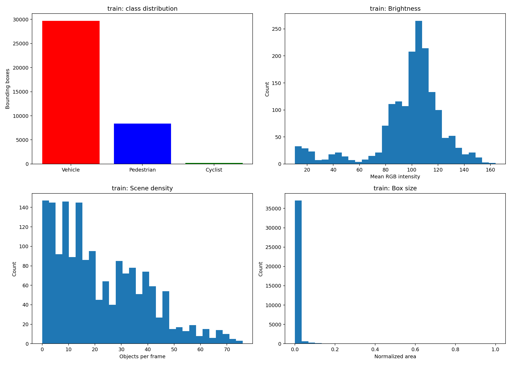
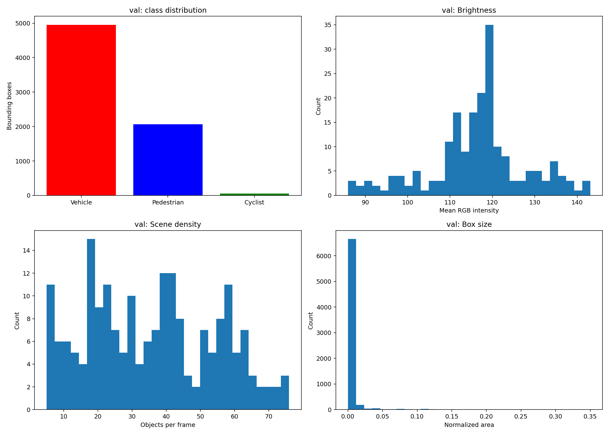
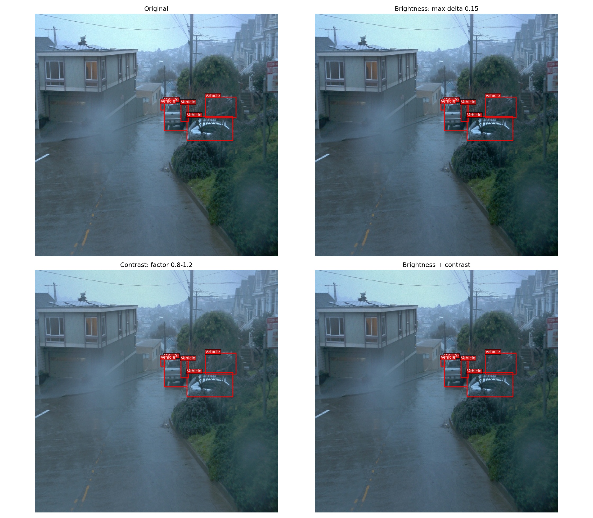
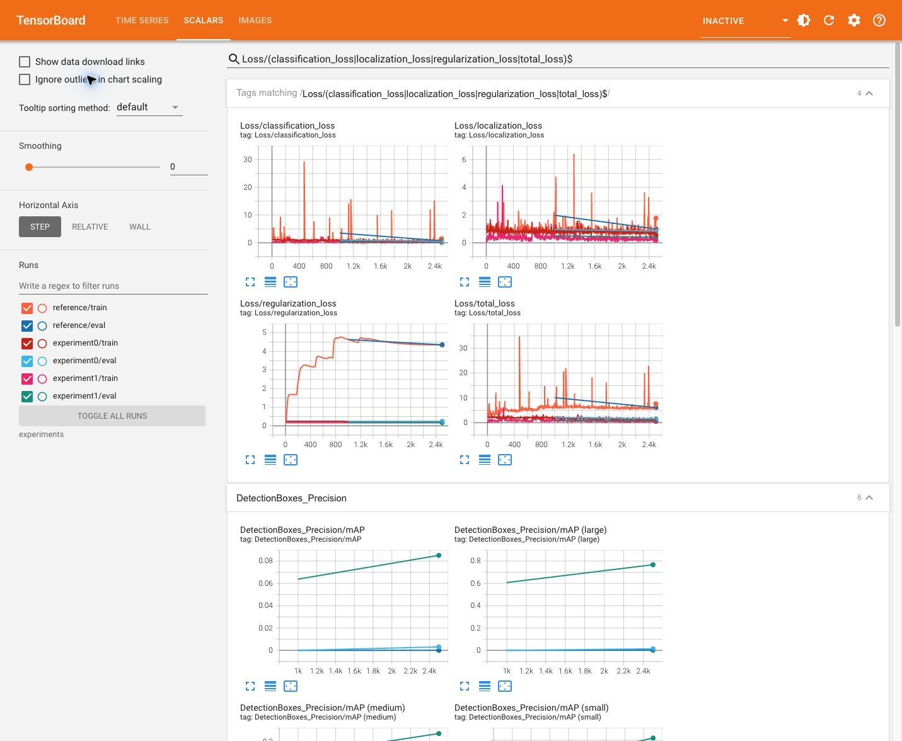
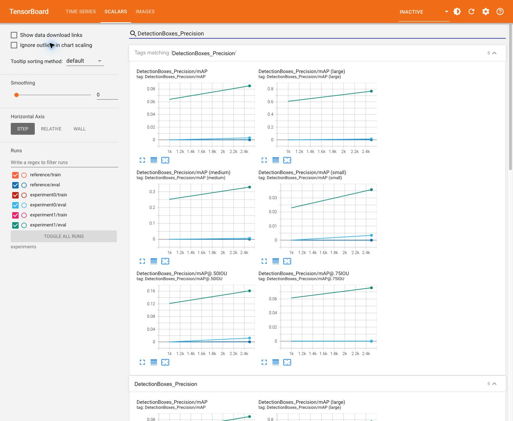
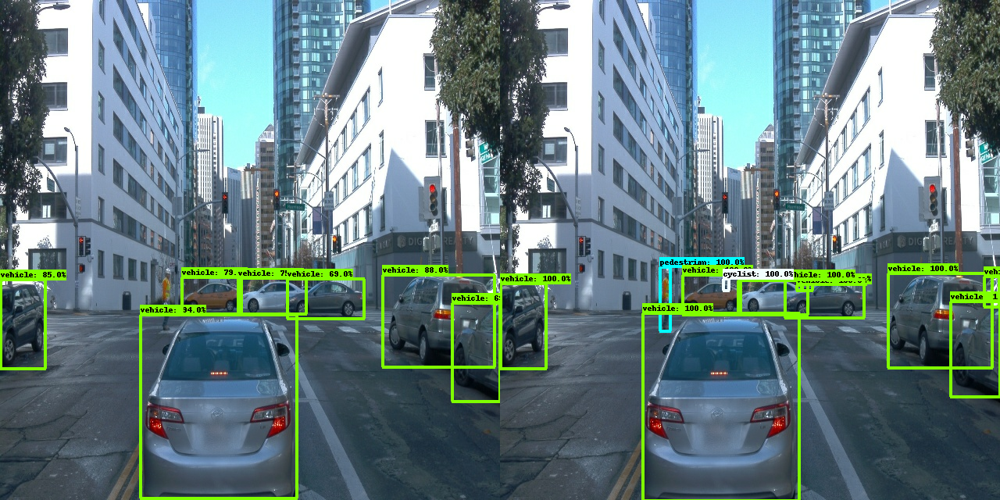
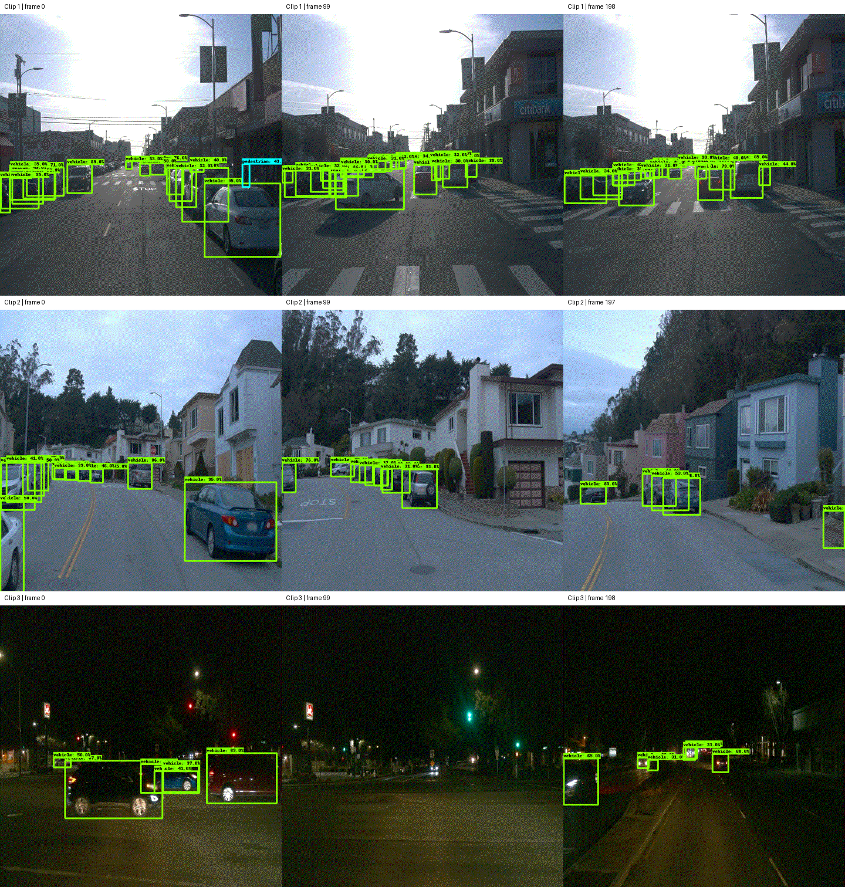

# Object Detection in an Urban Environment

This project fine-tunes an SSD ResNet-50 FPN detector on the supplied Waymo camera data to detect vehicles, pedestrians, and cyclists. Detection provides the location and category of nearby road users for downstream tracking and planning. These experiments are an educational evaluation, not a validated driving system.

## Data and exploratory analysis

The analysis uses every frame in the supplied Udacity splits. Counts below come from `artifacts/eda/statistics.json`, not estimates or a synthetic dataset.

| Split | Segments | Frames | Vehicles | Pedestrians | Cyclists |
| --- | ---: | ---: | ---: | ---: | ---: |
| Train | 86 | 1,719 | 29,710 | 8,355 | 214 |
| Validation | 10 | 198 | 4,953 | 2,068 | 56 |
| Test | 3 | 596 | 8,867 | 844 | 0 |

All decoded images are 640 × 640 RGB. Vehicles dominate the training annotations (77.6%), while cyclists account for only 0.56%. Aggregate mAP alone can hide poor cyclist performance. The test subset has no cyclist annotations, so it cannot establish cyclist recall; the validation set is necessary for that class.



The seed-42 reservoir sample spans all training segments and contains residential streets, crowded intersections, distant vehicles, partial occlusion, nighttime glare, and a cyclist. Bounding boxes are red for vehicles, blue for pedestrians, and green for cyclists. Small distant objects and crowded scenes are particularly difficult at the supplied resolution.



| Measurement | Train | Validation | Test |
| --- | ---: | ---: | ---: |
| Mean objects/frame | 22.27 | 35.74 | 16.29 |
| Mean RGB brightness | 98.02 | 116.56 | 77.41 |
| Brightness standard deviation | 27.36 | 11.41 | 41.37 |
| Median normalized box area | 0.000650 | 0.000356 | 0.007433 |

Validation is brighter, more crowded, and contains smaller median boxes than training. Consequently, a training/validation loss gap can reflect both overfitting and distribution shift; it cannot be attributed to overfitting from the gap alone. The median training box has an equivalent square side of about 16.3 pixels; validation is about 12.1 pixels. This motivates testing smaller anchors. Brightness is a descriptive image statistic, not a reliable weather or time-of-day label.



### Holdout strategy

The supplied 86/10/3 segment split is retained. Filenames are checked for overlap, and the complete file manifest is stored with the statistics. Entire driving segments stay together, avoiding the leakage that would result from randomly distributing adjacent video frames. This is a single holdout evaluation, not k-fold cross-validation; locations and recording sessions are not proven independent by filename disjointness alone. The starter documentation describes downsampled training/validation frames and full-rate test clips.

The three test clips are excluded from training, hyperparameter selection, and checkpoint selection. Their descriptive statistics are reported for coverage, and visual inference examples are produced only after model selection. For a new unsplit collection, `create_splits.py` makes reproducible whole-file symlinks and preserves the source files. Use `--test-fraction 0` when a separate held-out test set already exists. Existing incompatible splits are rejected rather than overwritten.

## Experiments

The reference and experiment 0 initialize from the official COCO-pretrained `ssd_resnet50_v1_fpn_640x640_coco17_tpu-8` checkpoint. They use batch size 2 and a matched 2,500-step cosine schedule with 250 warmup steps. Validation runs after steps 1,000 and 2,500, sequentially with training to avoid competing GPU memory allocations. This shorter schedule is an explicit compute-budget adaptation from the starter's 25,000 steps; the reference retains the starter's optimization and augmentation choices otherwise.

The starter label maps and records use IDs **1, 2, and 4**, while its model declares three classes. All three experiments reserve four output slots so cyclist ID 4 is representable. Slot 3 has no category in the label map. This compatibility correction is shared by all three experiments and is not counted as an improvement result.

| Setting | Reference | Experiment 0 |
| --- | --- | --- |
| Base learning rate | 0.04 | 0.0025 |
| Warmup learning rate | 0.013333 | 0.0005 |
| Freeze BatchNorm | False | True |
| Anchor scale | 4.0 | 2.0 |
| Horizontal flip and starter crop | Enabled | Enabled |
| Random brightness | None | Maximum delta 0.15 |
| Random contrast | None | Factor 0.8–1.2 |

### Rationale and API research

1. **Freeze BatchNorm:** batches of two give noisy batch statistics. Reusing pretrained statistics is a plausible fine-tuning strategy explicitly discussed in the [`freeze_batchnorm` field documentation](https://github.com/tensorflow/models/blob/master/research/object_detection/protos/ssd.proto). This is a hypothesis to validate, not a guarantee.
2. **Smaller anchors:** [`MultiscaleGridAnchorGenerator`](https://github.com/tensorflow/models/blob/master/research/object_detection/anchor_generators/multiscale_grid_anchor_generator.py) defines base anchor size as feature stride times `anchor_scale`. At pyramid level 3, changing the scale from 4 to 2 changes the smallest square base anchor from 32 to 16 pixels, closer to the measured training median. The number of anchors and prediction tensor dimensions remain unchanged. Large-object matching may worsen, so validation must decide whether the combined change is useful. The field is defined in [`multiscale_anchor_generator.proto`](https://github.com/tensorflow/models/blob/master/research/object_detection/protos/multiscale_anchor_generator.proto).
3. **Brightness and contrast:** moderate photometric changes target illumination variability while preserving box geometry. The figure uses the installed API's actual `random_adjust_brightness` and `random_adjust_contrast` functions, with fixed seeds. See [`preprocessor.py`](https://github.com/tensorflow/models/blob/master/research/object_detection/core/preprocessor.py) and [`preprocessor.proto`](https://github.com/tensorflow/models/blob/master/research/object_detection/protos/preprocessor.proto).
4. **Lower learning rate:** the reference learning rate was intended for a much larger batch. A lower rate is tested for more stable fine-tuning at batch size two.



The augmentation figure isolates the added photometric transforms; it does not depict the entire training pipeline. Horizontal flipping and the starter crop remain enabled. Several changes are combined in experiment 0, so this comparison cannot attribute an improvement to any single change. An ablation study would be required for that claim.

### Follow-up: transfer compatible prediction weights

Inspection of the installed API's `SSDMetaArch.restore_from_objects` showed that the `detection` checkpoint type restores the feature extractor, while `full` also restores prediction layers. The [API implementation](https://github.com/tensorflow/models/blob/master/research/object_detection/meta_architectures/ssd_meta_arch.py) is the basis for a third experiment after the short runs produced poor validation detection metrics.

`prepare_head_transfer.py` copies every compatible model tensor and adapts the final classifier kernel and bias from 91 COCO slots (background included) to five slots. It maps COCO car (3) to vehicle (1), person (1) to pedestrian (2), and bicycle (2) to cyclist (4), preserving background and suppressing unused slot 3. These IDs are defined in the [official COCO label map](https://github.com/tensorflow/models/blob/master/research/object_detection/data/mscoco_label_map.pbtxt). Car and bicycle are only initialization proxies: Waymo vehicles include other vehicle types, and a bicycle alone is not a cyclist. Training still uses the original Waymo labels.

Experiment 1 uses full restoration from this adapted checkpoint, frozen BatchNorm, the original anchor scale of 4 (to preserve pretrained box geometry), a base learning rate of 0.001, warmup rate 0.0001, and the same photometric augmentations and 2,500-step budget. The transfer copied 461 compatible tensors and remapped the classifier kernel and bias. Every copied/remapped tensor is checked for exact equality after checkpoint serialization and restoration. Independent tests check channel order separately for all six anchors and suppression of the unused class. This follow-up changes initialization, anchor scale, and learning rate together; it is not a single-variable ablation.

### Measured results

All metrics below were measured on the same 198 validation frames. mAP is COCO AP averaged over IoU 0.50–0.95 on a 0–1 scale; AP50 uses IoU 0.50. AR100 allows up to 100 detections per image. The complete scalar values and timestamps are in [`scalars.json`](artifacts/metrics/scalars.json).

| Run | Step | mAP | AP50 | AR100 | Validation total loss |
| --- | ---: | ---: | ---: | ---: | ---: |
| Reference | 1000 | 0.000017 | 0.000097 | 0.002564 | 10.1184 |
| Reference | 2500 | 0.000081 | 0.000318 | 0.003722 | 6.1006 |
| Experiment 0 | 1000 | 0.000013 | 0.000061 | 0.001386 | 2.1867 |
| Experiment 0 | 2500 | 0.003113 | 0.012126 | 0.028118 | 1.5631 |
| Experiment 1 | 1000 | 0.063804 | 0.121282 | 0.091186 | 0.9929 |
| Experiment 1 | 2500 | 0.085115 | 0.161186 | 0.127355 | 0.8079 |

**Selected model: experiment 1, step 2,500**, the highest validation mAP among all six evaluated checkpoints. Test images were not consulted for selection. The retained checkpoint and all candidates are recorded in [`model_selection.json`](artifacts/model_selection.json).





These are actual TensorBoard screenshots with smoothing set to zero. Validation has two measured points per run; connecting lines do not represent intermediate evaluations. The standalone [loss plot](artifacts/metrics/loss_comparison.png) is also available.

| Run | Mean training loss, steps 2,400–2,499 | Validation loss, step 2,500 |
| --- | ---: | ---: |
| Reference | 5.9571 | 6.1006 |
| Experiment 0 | 1.4479 | 1.5631 |
| Experiment 1 | 0.6379 | 0.8079 |

The reference has substantial loss spikes and its final regularization loss is 4.3539, compared with 0.2397 for experiment 0 and 0.1726 for experiment 1. Thus total loss alone would be a poor detector-quality comparison. The reference produces almost no useful validation detections; experiment 0 reduces loss substantially but still has low mAP. Retaining compatible pretrained prediction weights in experiment 1 gives the strongest measured result.

Experiment 1 improves validation mAP from 0.0638 to 0.0851 between the two checkpoints while validation loss falls from 0.9929 to 0.8079. Its final training/validation loss gap is about 0.1700. This gap is consistent with harder validation scenes and possible overfitting, but two validation checkpoints and differently augmented training batches cannot distinguish these effects. The validation curve does not show deterioration over the measured interval.

Small-object AP remains only **0.0359**, versus **0.3293** for medium objects and **0.7672** for large objects. Size-specific metrics can have different category coverage and are not a simple weighted decomposition of overall mAP. The result is a substantial improvement over the short reference run, but overall detection quality remains limited. Useful next experiments would isolate the initialization/anchor/rate changes, extend the training schedule, and evaluate more rare-class and night scenes. These follow-ups have not been performed.

Each configuration was trained once; these are not replicated estimates with confidence intervals. Experiment 0 was restored from step 1,000 after a workspace interruption and resumed to 2,500. Raw event files are retained; scalar exports keep the last timestamp for repeated tag/step pairs. EDA and augmentation visualization use fixed seeds, but GPU training is not claimed to be bitwise reproducible.



The preceding image is an unmodified Object Detection API validation summary: predictions on the left and ground truth on the right. Several nearby vehicles are localized correctly, but the annotated pedestrian and cyclist in this example are missed. Test animation results are documented below.

## Held-out test animations

All three supplied test segments were rendered in their original frame order with the selected model, a fixed confidence threshold of 0.3, and 10 FPS. The GIFs contain 199, 198, and 199 frames, respectively: all **596 test frames**, with no truncation at the 300-frame safety limit. Pillow verifies frame counts and 100 ms frame durations; JSON sidecars preserve the inference settings. These are qualitative examples, not a separately measured test mAP.

- [Clip 1: 199 frames](artifacts/inference/segment-12012663867578114640_820_000_840_000_with_camera_labels.gif)
- [Clip 2: 198 frames](artifacts/inference/segment-1208303279778032257_1360_000_1380_000_with_camera_labels.gif)
- [Clip 3: 199 frames](artifacts/inference/segment-12200383401366682847_2552_140_2572_140_with_camera_labels.gif)



The first two clips show daytime urban streets and the third shows a night intersection. Nearby cars are often localized, including vehicles in the night scene. Distant or occluded objects are missed, and overlapping/low-confidence vehicle boxes include apparent false positives. In the middle frame of clip 1, a pedestrian prediction appears over the vehicle area, illustrating a classification error. The threshold was fixed before viewing these test outputs. GIF palette quantization and 480-pixel preview resizing affect visual appearance, not the model's 640-pixel input.

## Reproduce in the Udacity GPU workspace

Enable GPU mode in the classroom. Run commands from `/home/workspace` using the supplied `sdc-c1-gpu-augment` environment. The runtime reports Python 3.7.3 and TensorFlow 2.3.0 and recognizes a Tesla T4. `artifacts/runtime.json` records imported versions; `artifacts/environment-requirements.txt` records installed distribution metadata. The latter is an environment audit, not a clean installation lockfile: this legacy workspace has multiple TensorFlow distributions and local package paths.

The existing [`build/Dockerfile`](build/Dockerfile), [`build/requirements.txt`](build/requirements.txt), and [build instructions](build/README.md) describe the starter's separate NVIDIA/Linux setup. That Docker image has not been rebuilt or validated for these results. The Mac is used for editing and lightweight tests; CUDA training runs in Udacity.

```bash
# If needed, activate the environment already supplied by Udacity.
source /data/virtual_envs/sdc-c1-gpu-augment/bin/activate
cd /home/workspace

# CPU-only analysis avoids allocating GPU memory during model training.
CUDA_VISIBLE_DEVICES='' python run_eda.py
CUDA_VISIBLE_DEVICES='' python run_augmentations.py
CUDA_VISIBLE_DEVICES='' jupyter nbconvert --to notebook --execute --inplace \
  'Exploratory Data Analysis.ipynb' 'Explore augmentations.ipynb'

# Optional: only for a NEW, unsplit collection.
python create_splits.py --source /path/to/processed \
  --destination /path/to/splits --seed 42
```

Download and extract the [official pretrained checkpoint](https://storage.googleapis.com/download.tensorflow.org/models/object_detection/tf2/20200711/ssd_resnet50_v1_fpn_640x640_coco17_tpu-8.tar.gz) under `experiments/pretrained_model/`. The storage URL provides HTTPS with a matching certificate.

```bash
python edit_config.py --train_dir data/train --eval_dir data/val \
  --batch_size 2 --label_map label_map.pbtxt --steps 2500 \
  --checkpoint experiments/pretrained_model/ssd_resnet50_v1_fpn_640x640_coco17_tpu-8/checkpoint/ckpt-0 \
  --output experiments/reference/pipeline_new.config
# Repeat with --improved and --output experiments/experiment0/pipeline_new.config.

CUDA_VISIBLE_DEVICES='' python prepare_head_transfer.py \
  --source experiments/pretrained_model/ssd_resnet50_v1_fpn_640x640_coco17_tpu-8/checkpoint/ckpt-0
# This creates the adapted checkpoint and experiment1 configuration.

python experiments/model_main_tf2.py --model_dir=experiments/reference \
  --pipeline_config_path=experiments/reference/pipeline_new.config \
  --num_train_steps=1000 --checkpoint_every_n=500
python evaluate_once.py --model-dir experiments/reference --steps 1000
# Resume with --num_train_steps=2500, evaluate, then run experiment0 and experiment1 likewise.
# For fresh experiment directories, run_experiments.sh performs this sequence.

python export_metrics.py --logdir experiments --output artifacts/metrics
python -m tensorboard.main --logdir experiments
```

Do not regenerate a configuration inside an ongoing or completed experiment. Use a new experiment directory for a changed setting. Saved configurations contain the actual workspace paths; regenerate them for another machine.

### Export and test inference

After all validation runs finish, select the checkpoint using validation mAP:

```bash
CUDA_VISIBLE_DEVICES='' python select_model.py
python experiments/exporter_main_v2.py --input_type image_tensor \
  --pipeline_config_path experiments/selected/pipeline_new.config \
  --trained_checkpoint_dir experiments/selected \
  --output_directory experiments/selected/exported
python inference_video.py --labelmap_path label_map.pbtxt \
  --model_path experiments/selected/exported/saved_model \
  --tf_record_path data/test/SEGMENT.tfrecord \
  --output_path artifacts/inference/SEGMENT.gif \
  --fps 10 --max_frames 300 --score_threshold 0.3
```

Replace `SEGMENT.tfrecord` with a supplied test filename. GIF output uses Pillow; MP4 additionally requires an `ffmpeg` executable with H.264 support. Each animation has a JSON sidecar recording its source, model, frame count, playback rate, and confidence threshold. The 480-pixel preview size applies only to rendering; inference uses the supplied 640-pixel images. Large model weights and source records are excluded from Git.

Only after writers stop, `python split_event_files.py` can divide event files into chunks below GitHub's per-file limit. Record boundaries are preserved, concatenated bytes must have the same SHA-256 as the original, and the original is archived under ignored `artifacts/raw_events/`. TensorBoard can read the chunks together from the original run directory.

### Files

| File | Purpose |
| --- | --- |
| `analysis_utils.py` | Non-mutating, class-colored box rendering |
| `run_eda.py` | Full-split statistics, reservoir samples, and figures |
| `run_augmentations.py` | Actual API brightness/contrast visualization |
| Both `.ipynb` files | Executed EDA and augmentation walkthroughs |
| `create_splits.py` | Deterministic segment-level splitting with a manifest |
| `edit_config.py` | Validated paths, sparse label IDs, reference/improvement settings |
| `evaluate_once.py` | Evaluate a completed checkpoint without a long polling delay |
| `run_experiments.sh` | Sequential training and validation for all three experiments |
| `prepare_head_transfer.py` | Verified COCO predictor adaptation for experiment 1 |
| `select_model.py` | Select the retained checkpoint with highest validation mAP |
| `split_event_files.py` | Split large event files without changing TFRecord bytes |
| `export_metrics.py` | Extract measured scalar values, loss plots, and evaluation images |
| `inference_video.py` | Ordered inference with streaming MP4 or bounded GIF output |
| `experiments/` | Configurations, training/evaluation logs, TensorBoard events |
| `artifacts/` | Measured statistics, figures, and environment evidence |
| `tests/` | Split preservation, coordinate scaling, sparse labels, config checks |

## Verification and submission status

- Udacity runtime: **12/12 tests passed**, including configuration generation, sparse class IDs, classifier-channel remapping, split preservation, coordinate scaling, and event-file splitting. See [`tests-final.log`](artifacts/tests-final.log).
- Local macOS checks: **8 passed, 4 skipped** because TensorFlow/Object Detection API is absent locally; the four skipped tests passed in Udacity. Modified Python modules pass Ruff E/W/F checks (the required Matplotlib backend-before-pyplot import order is exempted), Python 3.7 syntax checks, and shell syntax checks.
- Both notebooks validate and retain their executed outputs: four EDA code cells and two augmentation code cells, with no error outputs.
- Three training runs, six validation checkpoints, model export, and inference on all 596 held-out frames completed on Udacity's Tesla T4. The saved model is available locally and in the workspace at `experiments/selected/exported/saved_model/`; large weights are intentionally excluded from Git.
- The local submission copy's oversized event files were split without changing their concatenated bytes. SHA-256 manifests and decoder checks are in `artifacts/event_file_splits.json` and `artifacts/event_split_verification.json`. Original files remain in ignored `artifacts/raw_events/`.
- The starter Docker environment and MP4/ffmpeg path were **not** tested; the supplied Udacity environment and GIF path were used.

The submission repository is [ruddyscent/nd013-c1-vision-starter](https://github.com/ruddyscent/nd013-c1-vision-starter). The work is organized into separate commits for data preparation, exploratory analysis, training tools, measured experiment results, and the submission report. Classroom submission is a separate step and has not been performed.
